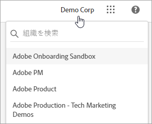
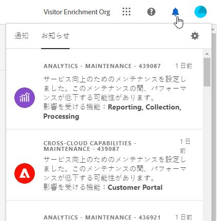
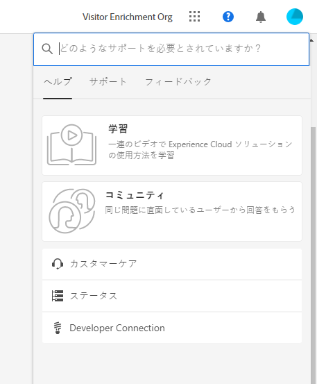

# CX Enterpriseの導入方法 {#get-started}

[Adobe CX Enterprise](https://experience.adobe.com)にログインしてアプリケーションを起動し、統合ヘッダーを使用してプロファイルの管理、通知の確認、ヘルプの検索をすべて1か所で行います。

## 始める前に {#before-you-begin}

組織のCX Enterprise製品用にプロビジョニングされたAdobe IDが必要です。 ログインできない場合や、予定されているアプリケーションが表示されない場合は、[!UICONTROL CX Enterprise] [管理者](administration/admin-console.md)にお問い合わせください。

## CX Enterpriseにログイン {#sign-in}

ログインし、自分が適切な[組織](administration/organizations.md)に属していることを確認します。

1. [Adobe CX Enterprise](https://experience.adobe.com)に移動します。
1. Adobeの電子メールアドレスを入力し、**[!UICONTROL 続行]**&#x200B;をクリックします。
1. アカウントをクリックします。
1. パスワードを入力します。
1. 自分が適切な組織に属していることを確認します。

   

   **組織の検証**

   [組織](administration/organizations.md)は、インターフェイスヘッダーに表示されます。

   組織でFederated IDを使用している場合は、CX Enterpriseを使用すると、メールアドレスとパスワードを入力しなくても、組織のシングルサインオンでログインできます。 CX Enterprise URL （`https://experience.adobe.com`）に`#/sso:@domain`を追加して、このタスクを実行します。

   例えば、Federated ID を持ち、ドメインが `example.com` の組織の場合、URL リンクを `https://experience.adobe.com/#/sso:@example.com` に設定します。 また、この URL にアプリケーションパスを付けてブックマークに追加することで、特定のアプリケーションに直接移動することもできます。 （例えば、Adobe Analytics の場合は `https://experience.adobe.com/#/sso:@example.com/analytics`。）

   **注：**&#x200B;お客様の組織の管理者は、IP アドレスによってAdobe製品へのアクセスを制限することができます。 その場合、CX Enterpriseにログインするか、これを有効にした組織に切り替えた後にエラーが発生する可能性があります。 詳細については、[IP アドレスによる製品アクセスの制限](https://helpx.adobe.com/enterprise/using/ip-based-access.html)を参照してください。

## CX Enterpriseアプリケーションへのアクセス {#applications}

CX Enterpriseにログインすると、統合ヘッダーからすべてのアプリケーション、サービス、組織にすばやくアクセスできます。

組織内でプロビジョニングされたCX Enterprise アプリケーションとサービスにアクセスするには、アプリケーションセレクターに移動します。

## ユーザープロファイルの管理 {#profile}

[!UICONTROL &#x200B; プロファイル &#x200B;] メニューでは、次の操作を実行できます。

* ダークテーマを指定する（このテーマに対応していないアプリケーションもあります）
* CX Enterprise [環境設定](features/account-preferences.md)の管理
* [組織](administration/organizations.md)を選択または検索する
* [!UICONTROL 法的通知]を表示
* ログアウト
* アカウントの環境設定、通知、サブスクリプションを設定する

## 製品内通知とお知らせの表示 {#notifications}

ベルアイコンをクリックすると、通知とお知らせが表示されます。 お知らせには、製品リリース、メンテナンス通知、共有項目、承認リクエストなど、関連性の高い実用的な更新が含まれる場合があります。

通知とアラートを管理するには、[&#x200B; アカウントの環境設定と通知](features/account-preferences.md)を参照してください。

## ヘルプとサポート {#help}

[Experience League](https://experienceleague.adobe.com/ja#home)に関するヘルプコンテンツ（ドキュメント、チュートリアル、コース）や個々のアプリケーションに関するその他のリソースなど、ヘッダーの&#x200B;**[!UICONTROL ヘルプセンター]** （）を使用して、学習とヘルプにアクセスします。 自由形式のフィードバックを送信して、優先度の高いサポートチケットを作成することもできます。

[!UICONTROL &#x200B; ヘルプ &#x200B;] メニューでは、次のアクセス権も使用できます。

* **[!UICONTROL サポート &#x200B;]:** サポートチケットを作成するか、Twitterを使用して[!UICONTROL &#x200B; サポート &#x200B;]にお問い合わせください。
* **[!UICONTROL フィードバック &#x200B;]:** CX Enterprise エクスペリエンスに関するフィードバックを共有します。 フィードバックは、アドビの製品およびサービスを改善するために使用されます。
* **[!UICONTROL ステータス &#x200B;]:**&#x200B;に移動して、`https://status.adobe.com/experience_cloud`製品の運用状態と[!UICONTROL &#x200B; サブスクリプションの管理]を確認します。
* **[!UICONTROL Developer Connection]:** `adobe.io`に移動して、開発者向けドキュメントを見つけます。

## このトピックの詳細ヘルプ {#more-help}

* [Admin Consoleのユーザー管理および製品管理](administration/admin-console.md)
* [People サービスの基本を学ぶ](services/getting-started.md)
* [アカウントの環境設定と通知](features/account-preferences.md)
