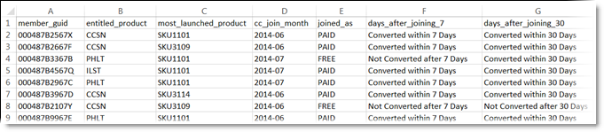
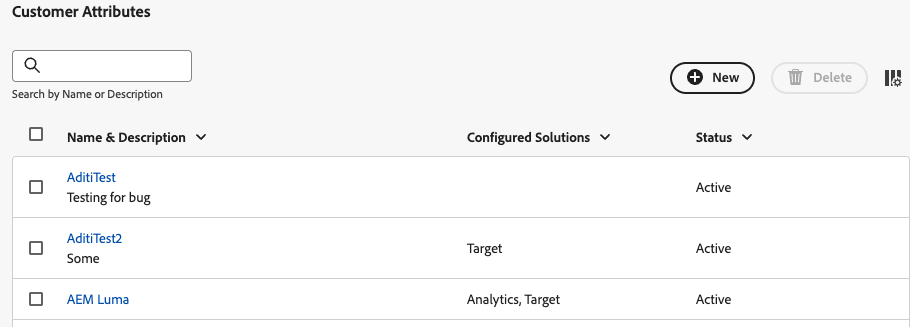
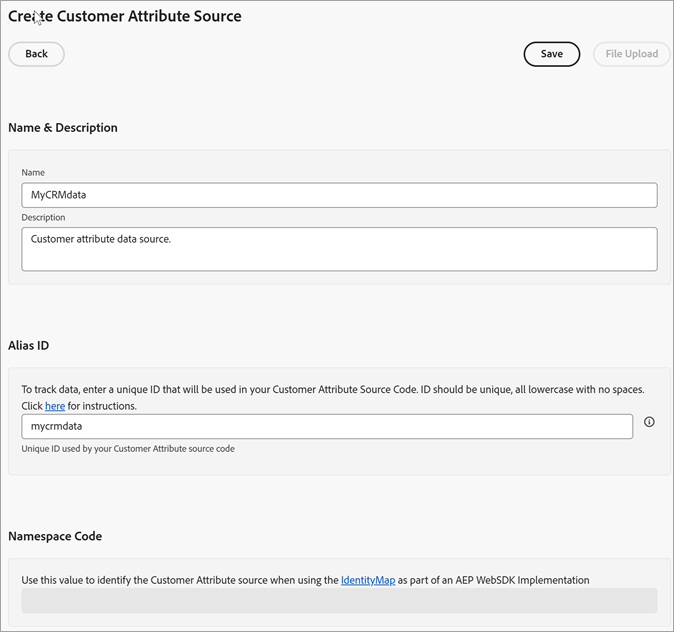
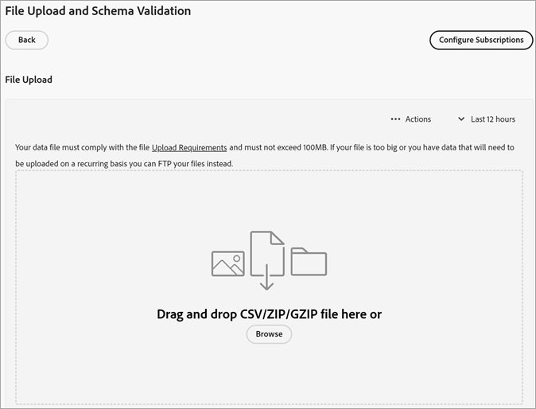
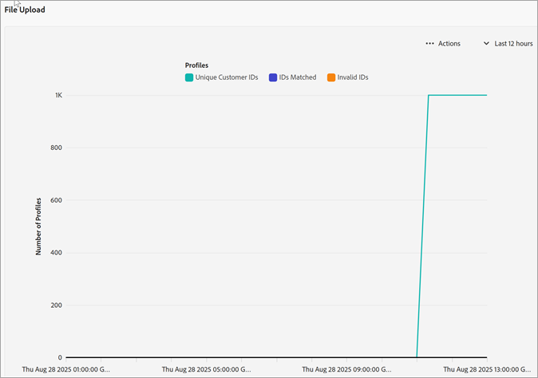
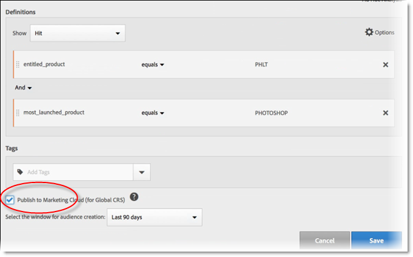
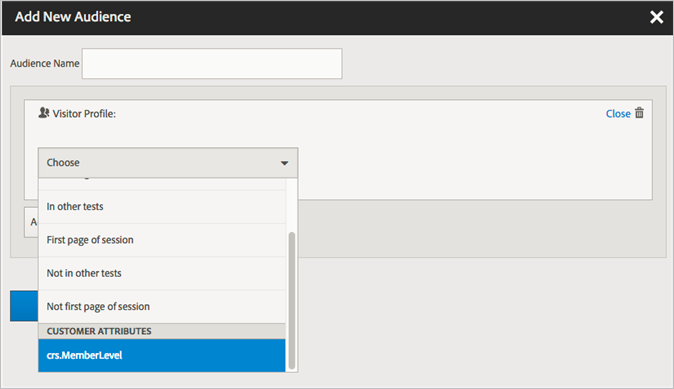

# 顧客属性データの作成とアップロード {#create-upload-customer-attribute-data}

[!DNL Customer Attributes] データソースを作成し、エンタープライズ顧客データをアップロードし、準備ができたらソースをアクティブ化します。 ソースがアクティブになったら、属性データを[!DNL Analytics]および[!DNL Target]と共有します。

## 始める前に {#before-you-begin}

顧客属性データをアップロードする前に、次の要件を満たしていることを確認してください。

* **グループメンバーシップ：** データをアップロードするには、ユーザーが[!DNL Customer Attributes] グループのメンバーである必要があります。 また、Adobe Analytics グループまたは Adobe Target グループのいずれかに属している必要もあります。

  会社が顧客属性にアクセスできるかどうかを確認するには、[!DNL CX Enterprise]管理者が[CX Enterprise](https://experience.adobe.com)にログインする必要があります。 **[!UICONTROL Admin Console]** > **[!UICONTROL 製品]**&#x200B;に移動します。 *[!DNL Customer Attributes]*&#x200B;が[!UICONTROL 製品プロファイル &#x200B;]の1つとして表示される場合は、開始する準備ができています。

  [!DNL Customer Attributes]に追加されたユーザーには、CX Enterprise インターフェイスの左側に「[!DNL Customer Attributes]」メニュー項目が表示されます。

* 顧客属性には、**Adobe Target** `at.js`（任意のバージョン）または `mbox.js` バージョン 58 以降が必要です。

  [at.js のデプロイ方法](https://experienceleague.adobe.com/en/docs/target-dev/developer/client-side/overview)を参照してください。

## 顧客属性のワークフロー {#workflow}

次の図は、顧客属性データの作成、アップロードおよび使用のエンドツーエンドのワークフローを示しています。


## データファイルの作成 {#create-data-file}

このデータは、CRM の企業顧客データです。 データには、メンバー ID、権限付与されている製品、最も頻繁に起動する製品など、製品に関する購読者データが含まれます。

1. `.csv` ファイルを作成します。

   >[!NOTE]
   >
   >このプロセスの後半で、`.csv` ファイルをドラッグ&amp;ドロップしてファイルをアップロードします。 [FTP を使用してアップロード](t-upload-attributes-ftp.md#task_591C3B6733424718A62453D2F8ADF73B)する場合は、`.csv` と同じ名前の `.fin` ファイルも必要です。

   企業顧客データファイルの例：

   

1. ファイルをアップロードする前に、[&#x200B; データファイル要件](crs-data-file.md)の重要な情報を確認してください。
1. 引き続き[属性ソースを作成し、データをアップロードします](t-crs-usecase.md#create-source)。

## 属性ソースの作成とデータファイルのアップロード {#create-source}

CX Enterpriseの&#x200B;_[!UICONTROL 顧客属性の作成Source]_ ページで、次の手順を実行します。

>[!IMPORTANT]
>
>顧客属性ソースを作成、変更または削除する場合、ID が新しいデータソースと同期され始めるまで、最大 1 時間の遅延があります。 顧客属性ソースを作成または変更するには、Audience Manager の管理者権限が必要です。 Audience Manager カスタマーサポートまたはコンサルティングに連絡して、管理者権限を取得します。

1. **[!UICONTROL アプリ]**  > **[!DNL Customer Attributes]**&#x200B;をクリックして、[!UICONTROL 顧客属性]を開きます。

   

1. 「**[!UICONTROL 新規]**」をクリックします。

   

1. [!UICONTROL 顧客属性の作成Source] ページで、次のフィールドを設定します。

   * **[!UICONTROL 名前：]** データ属性ソースのわかりやすい名前。 [!DNL Adobe Target] の場合、属性名にスペースを含めることはできません。 スペースを含む属性が渡された場合、[!DNL Target] はその属性を無視します。 次の文字もサポートされていません。`< , >, ', "`

   * **[!UICONTROL 説明：]** （オプション） データ属性ソースの説明。

   * **[!UICONTROL エイリアス ID:]**&#x200B;特定のCRM システムなどの顧客属性データのソースを表します。 [!UICONTROL &#x200B; エイリアス ID]は、[!UICONTROL 顧客属性Source] コードで使用される一意のIDです。 ID は一意で、小文字を使用し、スペースを含まないようにしてください。 CX Enterpriseの顧客属性ソースの[!UICONTROL &#x200B; エイリアス ID] フィールドに入力される値は、実装から渡される値と一致する必要があります（Platform Data CollectionまたはMobile SDKのJavaScriptを介して）。

     >[!IMPORTANT]
     >
     >エイリアス IDに関連付けられたデータソースを削除しても、エイリアス IDは複数のサービスに保存され、それらの間でプロファイルをマッピングするために使用されるため、エイリアス IDは使用できません。

     エイリアス IDは、追加の顧客ID値を設定する特定の領域に対応します。 次に例を示します。

     * **タグ：** エイリアス IDは、[[!UICONTROL Experience Cloud ID サービス &#x200B;]](https://experienceleague.adobe.com/docs/experience-platform/tags/home.html?lang=ja) タグ拡張機能の[!UICONTROL 顧客設定]の&#x200B;*統合コード*&#x200B;の値に対応しています。

     * **訪問者ID サービス：** エイリアス IDは、各訪問者に関連付けることができる追加の[顧客ID](https://experienceleague.adobe.com/docs/id-service/using/reference/authenticated-state.html?lang=ja)に対応します。

       例：*crm_id* の場合：

       ```
       "crm_id":"67312378756723456"
       ```

     * **iOS:** エイリアス IDは、[visitorSyncIdentifiers:identifiers](https://experienceleague.adobe.com/docs/mobile-services/ios/overview.html?lang=ja)の&#x200B;*&quot;idType&quot;*&#x200B;に対応しています。

       例：

       `[ADBMobile visitorSyncIdentifiers:@{@<`**`"idType"`**`:@"idValue"}];`

     * **Android™：**&#x200B;エイリアス ID は [syncIdentifiers](https://experienceleague.adobe.com/docs/mobile-services/android/overview.html?lang=ja) の *&quot;idType&quot;*&#x200B;に対応しています。

       例：

       `identifiers.put(`**`"idType"`**`, "idValue");`

       エイリアス ID フィールドと顧客IDに関するデータ処理の詳細については、[複数のデータソースの活用](crs-data-file.md#section_76DEB6001C614F4DB8BCC3E5D05088CB)を参照してください。

   * **[!UICONTROL 名前空間コード：]**&#x200B;この値を使用して、AEP WebSDK実装の一部として[IdentityMap](https://experienceleague.adobe.com/en/docs/experience-platform/web-sdk/identity/overview)を使用する場合に、顧客属性ソースを特定します。

1. 「**[!UICONTROL 保存]**」をクリックします。

## ファイルをアップロード {#upload-customer-attributes}

顧客属性レコードが作成され、顧客属性を編集してファイルをアップロードできます。

1. [!DNL Customer Attributes] ページで、属性ソースをクリックします。
1. [!UICONTROL お客様データの編集Source] ページで、**[!UICONTROL ファイルのアップロード]**&#x200B;をクリックします。

   

1. `.csv`または`.zip`または`.gzip` データファイルをドラッグ&amp;ドロップ ウィンドウにドラッグ&amp;ドロップします。

   >[!IMPORTANT]
   >
   >特定のデータファイル要件が存在します。 詳しくは、[データファイル要件](crs-data-file.md)を参照してください。

   ファイルをアップロードすると、このページの「[!UICONTROL &#x200B; ファイルアップロード &#x200B;]」見出しの下にテーブルデータが表示されます。 スキーマを検証したり、購読を設定したり、FTP を設定したりできます。

   

### アップロード結果の確認 {#review-upload-results}

アップロードが完了したら、次のカウントを確認して、期待どおりに読み込まれたデータを確認します。

* **[!UICONTROL 一意の顧客ID:]**&#x200B;この属性ソースにアップロードした一意のIDの数を表示します。

* **[!UICONTROL Experience Cloud訪問者IDにエイリアスされた顧客提供ID:]** ECIDにエイリアスされたIDの数を表示します。

* **[!UICONTROL 高エイリアス数を持つ顧客提供ID:]** 500個以上のエイリアス付きECIDを持つ顧客提供IDの数を表示します。 このような顧客提供 ID は、個人ではなくある種の共有ログインを表している可能性が最も高くなります。 これらのIDに関連付けられた属性は、エイリアス数が10,000に達するまで、最新のエイリアス付きECID 500に分散されます。 その後、システムは顧客指定IDを無効にし、関連する属性を配布しなくなります。

## スキーマの検証 {#validate-schema}

検証プロセスでは、アップロードした属性（文字列、整数、数値など）に表示名と説明をマッピングできます。 また、スキーマを更新して属性を削除することもできます。

[スキーマの検証](validate-schema.md)を参照してください。 属性を削除するには、[&#x200B; スキーマから属性を削除](#delete-attributes)するを参照してください。

## スキーマからの属性の削除 {#delete-attributes}

サブスクリプションを削除して提供される属性を削除し、属性を再度追加する必要がある場合は、置換ファイルをアップロードします。

1. [!UICONTROL 顧客属性の編集Source] ページで、**[!UICONTROL Target]**&#x200B;または&#x200B;**[!UICONTROL Analytics]** サブスクリプションを削除します（**[!UICONTROL サブスクリプションの設定]**&#x200B;の下）。
1. 更新されたフィールドを含む新しいデータファイルをアップロードします。

## サブスクリプションの設定と有効化 {#configure-subscriptions}

サブスクリプションを設定すると、CX Enterpriseとアプリケーション間のデータフローが設定されます。 属性ソースを有効化すると、購読しているアプリケーションでデータが利用できるようになります。 アップロードした顧客レコードは、Web サイトまたはアプリケーションから入ってくる ID 信号と照合されます。

[&#x200B; サブスクリプションの設定とデータソースのアクティブ化](subscription.md)を参照してください。

## [!DNL Analytics]で属性データを使用 {#use-in-analytics}

Adobe Analytics などのアプリケーションで利用できるデータを使用して、データをレポートおよび分析し、マーケティングキャンペーンで適切なアクションを起こすことができます。

以下の例は、アップロードした属性に基づいた [!DNL Analytics] セグメントを示しています。 このセグメントは、最も頻繁に起動する製品が Photoshop である [!DNL Photoshop Lightroom] の購読者を示しています。



CX Enterpriseにセグメントを公開すると、CX Enterprise AudiencesおよびAudience Managerでセグメントを利用できるようになります。

## [!DNL Target]で属性データを使用 {#use-in-target}

[!DNL Target]では、オーディエンスの作成時に、[!UICONTROL 訪問者プロファイル &#x200B;] セクションから顧客属性を選択できます。 すべての顧客属性には、リスト内に接頭辞`crs.`が付いています。 これらの属性を、必要に応じて他のデータ属性と組み合わせることで、オーディエンスを作成します。



[!DNL Target]のヘルプの「[&#x200B; オーディエンスを作成](https://experienceleague.adobe.com/docs/target/using/audiences/create-audiences/audiences.html?lang=ja)」を参照してください。
